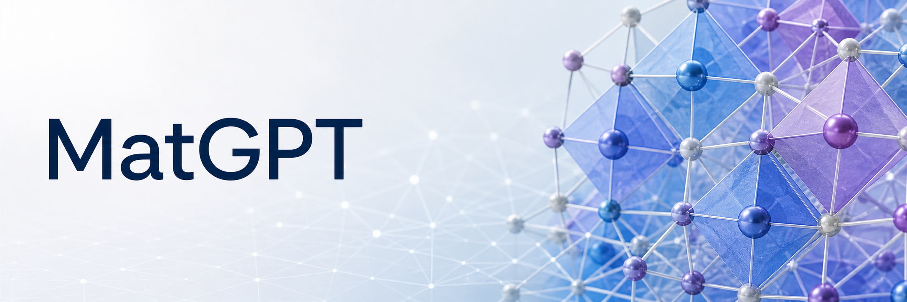

# MatGPT

Code for *MatGPT: Transformer-Based Generation of Inorganic Materials with Targeted Properties*. MatGPT is a decoder-only transformer that generates crystal structures as SLICES strings for target values of formation energy, band gap, bulk modulus and crystal system.

## Repository

| Folder | Model | Configs | Paper |
|---|---|---|---|
| `mat/` | Scaled-token conditioning, one property | `form`, `band`, `bulk` | Tables 1–3, Figs. 5–8 |
| `mat-multi/` | Scaled-token conditioning, two properties | `form_bulk`, `form_band`, `cs_form`, `cs_band`, `cs_bulk` | Tables 4–7, Figs. 9–12 |
| `mat-concat/` | Concatenation conditioning and the unconditional model | `form`, `uncond` | Section 3.3, ESI Section S9, Fig. 11 |
| `mat-multi-concat/` | Concatenation conditioning, two properties | `form_band` | ESI Section S9 |

## Installation

Linux, Python 3.10, CUDA 12.1. One environment covers all four folders:

```bash
git clone https://github.com/devalab/matgpt.git
cd matgpt
conda env create -n matgpt -f mat/environment.yml
conda activate matgpt
```

Versions are pinned in `requirements.txt` (SLICES 2.0.4, PyTorch 2.2.1, PyTorch Lightning 2.2.1, TensorFlow 2.15.0, matgl 1.1.3, megnet 1.3.2, pymatgen 2023.11.12). The property models are downloaded on first use.

## Data and trained models

Datasets and trained models: [figshare](https://doi.org/10.6084/m9.figshare.34330655)

- Formation energy and band gap: Alex-20 from MatterGPT (Dataset for MatterGPT v1, [10.5281/zenodo.16879675](https://doi.org/10.5281/zenodo.16879675)). The training file with the added crystal system label, `Training_dataset_alex20_with_encoding.csv`, is on figshare.
- Bulk modulus: `bulk_modulus_with_formation.csv`, 12,532 Materials Project compounds with their Materials Project IDs.
- Trained models: one zip per model, with the weights (`.pth`) and the vocabulary (`.json`):

| Zip | Folder | Config |
|---|---|---|
| `mat.zip` | `mat` | `form` |
| `mat-2.zip` | `mat` | `band` |
| `mat-3.zip` | `mat` | `bulk` |
| `mat-multi.zip` | `mat-multi` | `form_band` |
| `mat-multi-2.zip` | `mat-multi` | `form_bulk` |
| `mat-multi-space-form.zip` | `mat-multi` | `cs_form` |
| `mat-multi-space-band.zip` | `mat-multi` | `cs_band` |
| `mat-multi-space-bulk.zip` | `mat-multi` | `cs_bulk` |
| `mat-concat.zip` | `mat-concat` | `form` |
| `mat-uncond.zip` | `mat-concat` | `uncond` |
| `mat-multi-concat.zip` | `mat-multi-concat` | `form_band` |

Put the CSV files in the `dataset/` folder of the code folder you use, or pass `data_path.fname=/path/to/file.csv`.

Columns used:

- Alex-20: `SLICES`, `e_form`, `band_gap_ind`, `crystal_system_encoded`, `CIF`
- Bulk modulus: `slices`, `Formation_Energy`, `Bulk Modulus (CSV)`, `crystal_system_encoded`, `CIF Content`

The `CIF` and `CIF Content` columns are the reference structures for the novelty check.

## Running an experiment

Run the scripts from inside the code folder with the same config name. Formation energy, for example:

```bash
cd mat
python train.py --config-name form            # train the model
python sample_property.py --config-name form  # generate 500 SLICES strings per target
python sli_to_cif.py --config-name form       # reconstruct the structures
python form_proxy.py --config-name form       # predict properties and check novelty
python metrics.py --config-name form          # table values
```

The property prediction script depends on the config:

| Folder | Config | Script |
|---|---|---|
| `mat` | `form`, `band`, `bulk` | `form_proxy.py`, `band_proxy.py`, `bulk_proxy.py` |
| `mat-multi` | `form_bulk`, `form_band` | `form_bulk.py`, `band_form.py` |
| `mat-multi` | `cs_form`, `cs_band`, `cs_bulk` | `crystal_form.py`, `crystal_band.py`, `crystal_bulk.py` |
| `mat-concat` | `form`, `uncond` | `form_proxy.py` |
| `mat-multi-concat` | `form_band` | `band_form.py` |

Outputs are written to `outputs/<experiment>/` inside the code folder:

- `weights/`, `checkpoints/`, `logs/`: trained model, Lightning checkpoints and TensorBoard logs
- `sample/generated_with_property_<N>.csv`: generated SLICES strings
- `sample/output_structures/`: CIF files, `reconstructed_sequences_with_properties_<N>.csv` with the predicted properties, and plots
- `metrics.csv`: one row per target

To sample with a trained model from figshare instead of training one:

```bash
python sample_property.py --config-name form \
  sample.checkpoint_path=weights/<model>.pth \
  sample.vocab_and_model=weights/<model>.json
```

Targets are set in `sample.properties` and can be changed on the command line, for example `sample.properties='[-1.0,-2.0]'`, or `sample.properties='[[-1,100]]'` for two properties, in the order of `training.selected_properties`.

## Notes

- All hyperparameters are in the config files.
- The scaled-token models are trained on the first 90% of the rows of the dataset file and validated on the rest. The concatenation and unconditional models use a random 90:10 split with seed 20260910, which also seeds sampling.
- `metrics.py` computes validity, uniqueness, novelty, property errors and the crystal system match rate as defined in the paper.
- Crystal system labels (`crystal_system_encoded`): 1 triclinic, 2 monoclinic, 3 orthorhombic, 4 tetragonal, 5 trigonal, 6 hexagonal, 7 cubic.
- Models were trained on 2 × NVIDIA RTX 3090 (24 GB).

## Citation

H. S. V. Vasamsetti, P. K. Pal, M. Ehara and U. D. Priyakumar, *MatGPT: Transformer-Based Generation of Inorganic Materials with Targeted Properties*, submitted to Digital Discovery. See `CITATION.cff`.

## License

MIT, see `LICENSE`. SLICES (LGPL-2.1), matgl and megnet have their own licenses.
